<picture>
  <source media="(prefers-color-scheme: dark)" srcset="https://readme-typing-svg.demolab.com?font=Inconsolata&weight=600&size=38&duration=2400&pause=1200&color=E2E8F0&width=1000&height=60&lines=Data+platforms%2C+built+like+software.;Tested%2C+versioned%2C+trusted+numbers.">
  <source media="(prefers-color-scheme: light)" srcset="https://readme-typing-svg.demolab.com?font=Inconsolata&weight=600&size=38&duration=2400&pause=1200&color=0B1220&width=1000&height=60&lines=Data+platforms%2C+built+like+software.;Tested%2C+versioned%2C+trusted+numbers.">
  
</picture>

## About me

<blockquote align="center"><b><i>"I started with no technical background. Today I build the platforms teams run their numbers on."</i></b></blockquote>

I am an Analytics Engineer and Senior Data Analyst in Ho Chi Minh City. I build the data layer a business runs on: Airflow pipelines, dbt models on BigQuery and Snowflake with enforced contracts, a semantic layer that defines each metric once, and AI agents that answer from those definitions. I ship in small, tested changes, so teams get new numbers fast and keep trusting the old ones. I moved into data from business development and reached senior in under two years.

  
  
  

  
  

---

## Experience

<table cellpadding="8">
  <tr><td colspan="4"><b>Now</b></td></tr>
  <tr><td width="170">Apr 2026 –</td><td width="200"><b>MoMo (M_Service)</b></td><td>Senior Data Analyst, Financial Services</td><td>Fintech super-app, Vietnam</td></tr>
  <tr><td>Sep 2026 –</td><td><b>Orbital Kitchens</b></td><td>Analytics Engineer (contract, remote)</td><td>Cloud kitchens and food delivery, New York</td></tr>
  <tr><td colspan="4"><b>Before</b></td></tr>
  <tr><td>Jul 2024 – Mar 2026</td><td><b>MoMo (M_Service)</b></td><td>Data Analyst, Trainee to Mid-Level</td><td>MoMo Talent 2024, top 1% of applicants</td></tr>
  <tr><td>Dec 2025 – Aug 2026</td><td><b>MindX Technology School</b></td><td>Data Mentor (part-time)</td><td>SQL, Python, statistics</td></tr>
  <tr><td>Nov 2023 – Jul 2024</td><td><b>Gameloft Vietnam</b></td><td>Data Analyst Intern</td><td>Mobile games</td></tr>
  <tr><td>Dec 2022 – Nov 2023</td><td><b>VietSing Hospital</b></td><td>Operations Management</td><td>Healthcare</td></tr>
  <tr><td>Oct 2021 – Dec 2022</td><td><b>Shopee Vietnam</b></td><td>Business Development Executive</td><td>E-commerce</td></tr>
</table>

---

## Featured work

| Project | What it delivers |
|---|---|
| [saola-data-platform](https://github.com/loctu0402/saola-data-platform) | A complete analytics platform on BigQuery: dbt models under enforced contracts, Cube, Airflow, a daily report checked against expected values, an agent knowledge base with golden evals, and CI that tests only what a change touches. |
| [airflow-snowflake-testbed](https://github.com/loctu0402/airflow-snowflake-testbed) | Production-shaped test environments for Snowflake and Airflow: a zero-copy clone per branch, a per-branch Airflow behind Cloudflare, and task or DAG tests without opening the UI. |
| [prof-DA](https://github.com/loctu0402/prof-DA) | A Claude Code plugin that runs the analyst workflow, from framing the question to a reviewed stakeholder report. |
| [agent-analytic-package](https://github.com/loctu0402/agent-analytic-package) | A standard that keeps analytics agents to a certified knowledge base, released only after a golden evaluation set passes. |

Also: [dbt-sandbox](https://github.com/loctu0402/dbt-sandbox), where a data team learns and tests dbt on BigQuery, and [fintech-bank-fraud-detection](https://github.com/loctu0402/fintech-bank-fraud-detection), a fraud model taken to a scoring API and a drift monitor.

---

## Tech stack

<table>
  <tr><td width="24%"><b>Warehouse</b></td><td>
    
    
  </td></tr>
  <tr><td><b>Modeling</b></td><td>
    
    
    
    
    
  </td></tr>
  <tr><td><b>Orchestration</b></td><td>
    
    
    
  </td></tr>
  <tr><td><b>BI and reporting</b></td><td>
    
    
    
    
  </td></tr>
  <tr><td><b>Quality and catalog</b></td><td>
    
    
    
  </td></tr>
  <tr><td><b>Cloud and DevOps</b></td><td>
    
    
    
    
    
  </td></tr>
  <tr><td><b>AI</b></td><td>
    
    
    
    
  </td></tr>
</table>
