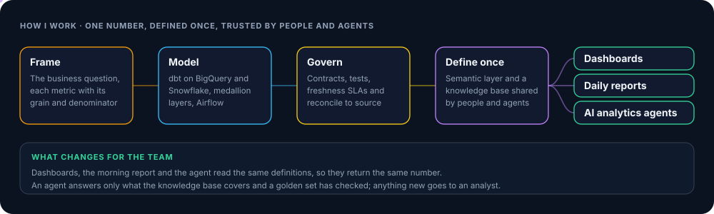
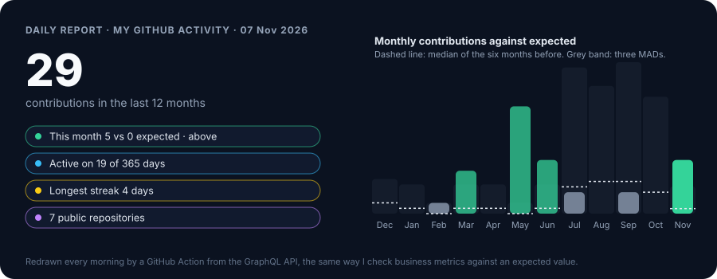

<picture>
  <source media="(prefers-color-scheme: dark)" srcset="https://readme-typing-svg.demolab.com?font=Inconsolata&weight=600&size=40&duration=2200&pause=900&color=E2E8F0&repeat=false&width=1000&height=64&lines=One+metric%2C+defined+once%2C+trusted+everywhere.">
  <source media="(prefers-color-scheme: light)" srcset="https://readme-typing-svg.demolab.com?font=Inconsolata&weight=600&size=40&duration=2200&pause=900&color=0B1220&repeat=false&width=1000&height=64&lines=One+metric%2C+defined+once%2C+trusted+everywhere.">
  
</picture>

## About me

<blockquote align="center"><b><i>"I started with zero technical background. Now I build the models, pipelines and agents that keep one number true."</i></b></blockquote>

I am a Senior Data Analyst and Analytics Engineer in Ho Chi Minh City, working remotely across Asia and US time zones. I moved from business development into data, and went from fresher trainee to senior in under two years. Most of my work is the layer between raw data and decisions: dimensional models in dbt, semantic layers, daily reporting that checks itself against an expected value, and AI agents that answer only from definitions a human has certified.

  
  
  

  
  
  

---

## Experience

<table cellpadding="8">
  <tr><td colspan="4"><b>Now</b></td></tr>
  <tr><td width="170">Apr 2026 –</td><td width="200"><b>MoMo (M_Service)</b></td><td>Senior Data Analyst, Financial Services</td><td>Fintech super-app, Vietnam</td></tr>
  <tr><td>Sep 2026 –</td><td><b>Orbital Kitchens</b></td><td>Analytics Engineer (contract, remote)</td><td>Cloud kitchens and food delivery, New York</td></tr>
  <tr><td colspan="4"><b>Before</b></td></tr>
  <tr><td>Jul 2024 – Mar 2026</td><td><b>MoMo (M_Service)</b></td><td>Data Analyst, Trainee to Mid-Level</td><td>MoMo Talent 2024, top 1% of applicants</td></tr>
  <tr><td>Dec 2025 – Aug 2026</td><td><b>MindX Technology School</b></td><td>Data Mentor (part-time)</td><td>SQL, Python, statistics</td></tr>
  <tr><td>Nov 2023 – Jul 2024</td><td><b>Gameloft Vietnam</b></td><td>Data Analyst Intern</td><td>Mobile games</td></tr>
  <tr><td>Dec 2022 – Nov 2023</td><td><b>VietSing Hospital</b></td><td>Operations Management</td><td>Healthcare</td></tr>
  <tr><td>Oct 2021 – Dec 2022</td><td><b>Shopee Vietnam</b></td><td>Business Development Executive</td><td>E-commerce</td></tr>
</table>

---

## Featured work

| Project | What it shows |
|---|---|
| [saola-data-platform](https://github.com/loctu0402/saola-data-platform) | End-to-end analytics engineering on BigQuery: medallion dbt models with contracts, Cube, Airflow, CD to a VM runner, a forecast-checked daily report and a contract-gated agent knowledge base. |
| [prof-DA](https://github.com/loctu0402/prof-DA) | Claude Code plugin that runs the analyst workflow as 12 governed modes, from framing to stakeholder report. |
| [agent-analytic-package](https://github.com/loctu0402/agent-analytic-package) | Process standard that makes an analytics agent answer from a certified knowledge base and a golden evaluation set. |
| [fintech-bank-fraud-detection](https://github.com/loctu0402/fintech-bank-fraud-detection) | Fraud detection from EDA to a calibrated model, a scoring API and a daily drift monitor. |

---

## Tech stack

<table>
  <tr><td width="24%"><b>Warehouse</b></td><td>
    
    
  </td></tr>
  <tr><td><b>Modeling</b></td><td>
    
    
    
    
    
  </td></tr>
  <tr><td><b>Orchestration</b></td><td>
    
    
  </td></tr>
  <tr><td><b>BI and reporting</b></td><td>
    
    
    
    
  </td></tr>
  <tr><td><b>Quality and catalog</b></td><td>
    
    
    
  </td></tr>
  <tr><td><b>Cloud and DevOps</b></td><td>
    
    
    
    
  </td></tr>
  <tr><td><b>AI</b></td><td>
    
    
    
    
  </td></tr>
</table>

---

## Stats

